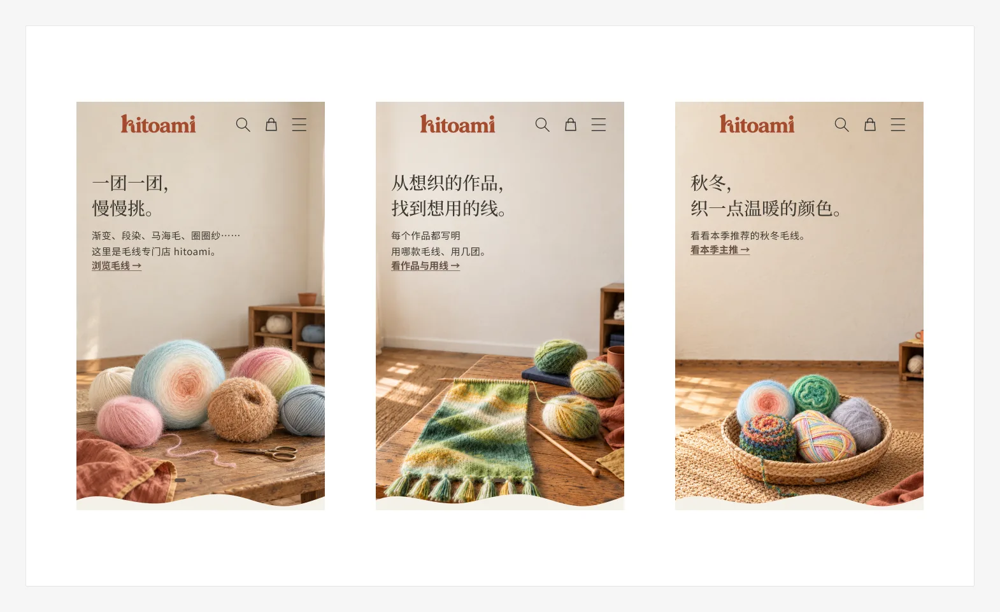

# 首屏 v4（#167，2026-10-17 用户批准）

- **视觉稿位置：** Figma「hitoami 本地原型（#131）」，手机页「Hero v4 · 真实商品参考生成（GPT Astra）· 手机 390」，桌面页同名「· 桌面 1440」。桌面 ①② 已按批准意见把右上的赤陶陶罐移出页头图标区；实现以仓库里的图片为准。
- **方向：** 沿用 hitoami.com 的手作小屋沉浸大图，左文右景、透明页头、波浪底边、三张手动切换。配色让环境里的陶器和亚麻带出 Logo 赤陶色 `#AB5631` 和黄油黄，画面里的毛线保留真实商品原有的颜色。
- **图片：** Codex 图像生成（gpt-6-astra），以 Shopify 真实商品主图为外观参考，生成后经过一轮对抗审查并重画。每张的参考商品和提示词记录在 `assets/hitoami-*.webp.source.json`。这类 AI 重绘真实毛线款式的做法是 PRODUCT.md 记录的例外。

| 张 | 场景 `scene` | 链接（留空时） | 日文标题 | 中文意思 |
|---|---|---|---|---|
| ① 毛线 | `yarn` | 毛线集合 | ひと玉ずつ、選ぶ楽しみ。 | 一团一团，享受挑选的乐趣 |
| ② 作品用线 | `kit` | 作品页 `/pages/kits` | 編みたいものから、糸を選ぶ。 | 从想织的作品出发挑线 |
| ③ 本季主推 | `season` | 本季主推 `/pages/season` | 秋冬の編みものに、あたたかな色を。 | 为秋冬的编织添一点温暖的颜色 |

三语全文（标题、说明、文字链）在 `templates/index.json` 的 `hero` 区块；文字链是浏览入口，不是购买按钮。
